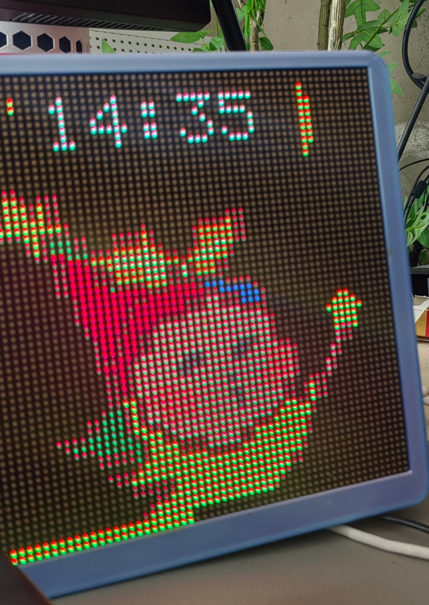
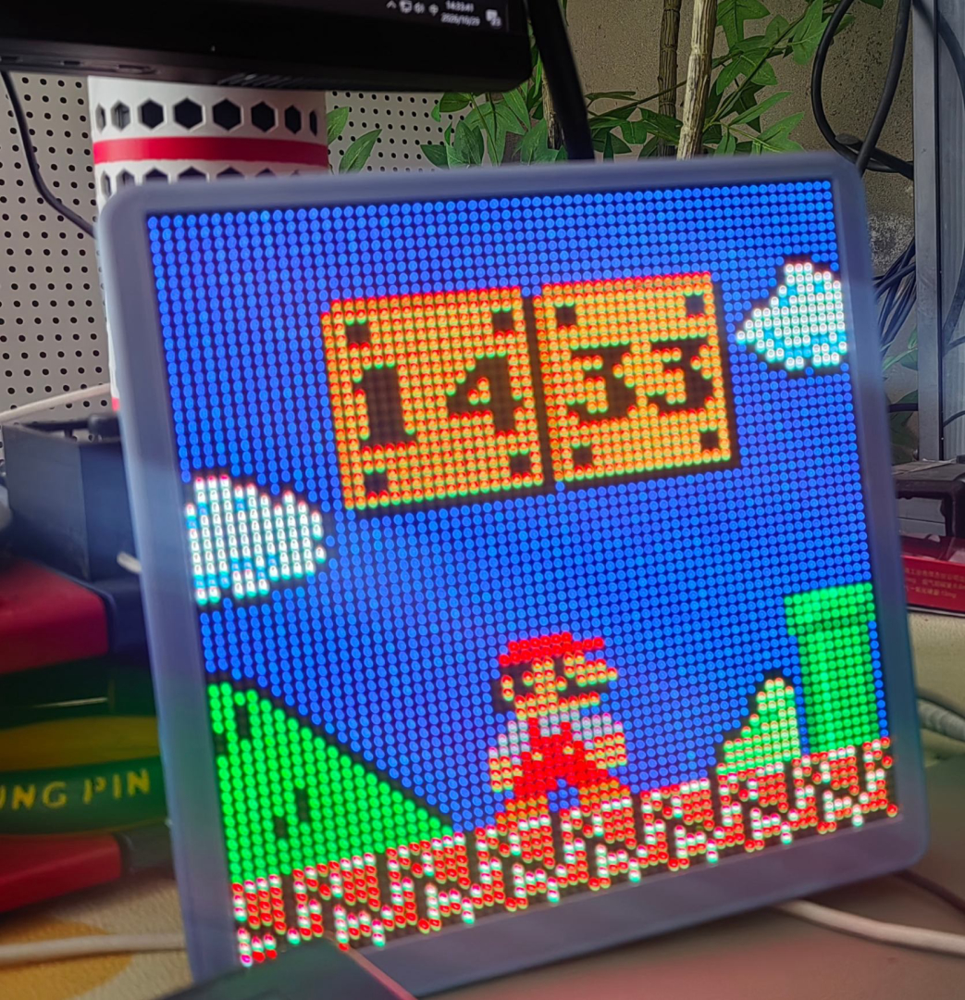
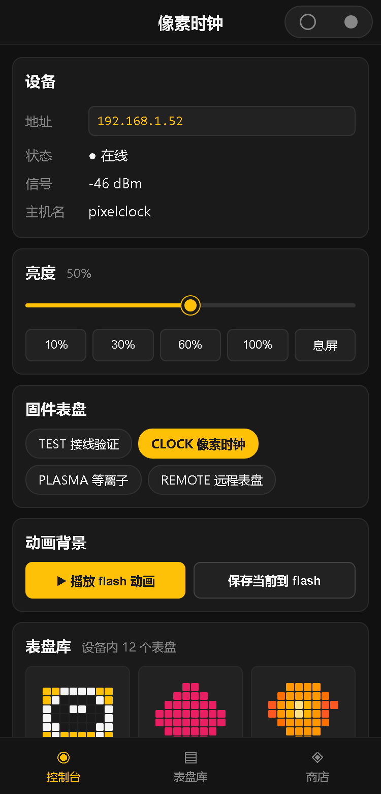

# HUB75 Pixel Clock 🕒

ESP32-S3 驱动的 **64×64 HUB75 全彩点阵像素时钟 / 氛围屏**开源固件。
板子自带网页控制台，支持表盘商店、亮度调节、屏幕旋转、WiFi 切换、动画播放，
开机自检 + 软启动供电保护，断网也能靠 NTP 缓存走时。

> HUB75 Pixel Clock — an open-source firmware for a 64×64 HUB75 RGB LED matrix
> clock driven by ESP32-S3, with a built-in web console (watch-face store,
> brightness, screen rotation, WiFi switching, animations).

---

## 📷 实拍展示

| 桌面实拍 · 时钟表盘 | 桌面实拍 · 像素动画场景 |
|---|---|
|  |  |

> 64×64 HUB75 全彩点阵，ESP32-S3 驱动，网页控制台实时切换表盘与动画。

## ✨ 特性

- **64×64 HUB75 全彩点阵**，双缓冲 DMA 驱动，刷新率约 120Hz
- **网页控制台**（`http://<板子IP>/`）：表盘商店 / 亮度滑块 / **屏幕旋转** / **WiFi 切换** / 动画
- **微信小程序控制端**（`miniprogram/`）：手机扫码即用，与网页版共用同一套 API
- **表盘商店**：内置多款表盘，可通过网页上传自定义 `.rgb565` 表盘
- **屏幕旋转**：0°/90°/180°/270° 一键切换，断电保存
- **WiFi 切换**：网页直接改 WiFi，连不上自动回落配网热点，永不失联
- **开机自检 + 供电软启动**：全屏自检亮度压到安全档，2.5s 亮度软爬坡，避免弱供电拉垮
- **NTP 时间同步**（CST-8），断网缓存走时
- **开源驱动参数**：矩阵初始化已对齐 WuyongLab-ESP32S3-PixelClock 同款已验证配置

| 项 | 值 |
|---|---|
| 主控 | ESP32-S3 **N16R8**（16MB Flash + 8MB PSRAM） |
| 屏 | P2.5 64×64 RGB HUB75 全彩点阵（5V/4A 额定，1/32 扫描） |
| 驱动库 | mrfaptastic/ESP32-HUB75-MatrixPanel-I2S-DMA |
| Flash 分区 | `partitions_16mb.csv`：OTA A/B + 表盘存储区 |
| 固件版本 | **v0.3.23** |

---

## ⚠️ 供电红线（先读再接线，不然烧板）

P2.5 全线密度高，全白实测可达 **4A 以上**。**严禁**从 ESP32 开发板 USB/VIN 取电给屏：

- 电源：独立 **5V/5A** 开关电源
- **供电走屏上的 VH4 插座（+5V/GND）**，排线只走信号
- 电源与屏 GND 必须和 ESP32 GND **共地**
- 屏 VCC/GND 入口并 **1000µF/25V 电解 + 0.1µF 陶瓷** 滤波

> 省钱提示：微雪 ESP32-S3-RGB-Matrix 驱动板（S3 + 排线座 + VH4 供电座三合一）可免飞线。

---

## 🔌 引脚映射（S3 专用，勿套老 ESP32 表）

N16R8 的 GPIO26~37 被 Flash + PSRAM 占用，GPIO19/20 是 USB。本映射已验证。

| HUB75 | GPIO | | HUB75 | GPIO |
|---|---|---|---|---|
| R1 | 4 | | CLK | 13 |
| G1 | 5 | | LAT | 11 |
| B1 | 6 | | OE | 12 |
| R2 | 7 | | A | 17 |
| G2 | 15 | | B | 18 |
| B2 | 16 | | C | 8 |
| | | | D | 9 |
| | | | **E** | **10** |

> E 脚（行扫描 16）**绝不能悬空**——64×64 是 1/32 扫描，缺 E 会上下半屏分裂。

可选外设：GPIO41/42 → SHT30 温湿度；GPIO14 → 蜂鸣器；GPIO0 → BOOT 键（短按切表盘 / 长按 3s 重置 WiFi）。

---

## 🛠️ 编译与烧录

需要 [PlatformIO](https://platformio.org/)（Core + ESP32 平台）：

```bash
cd hub75-pixel-clock
pio run                      # 编译
pio run -t upload            # 烧录（板子插 USB，必要时按住 BOOT 再插）
pio device monitor           # 115200 看启动日志
```

首次编译会自动拉取依赖（ESP32-HUB75-MatrixPanel-I2S-DMA 等）并下载工具链。
自定义板型定义在 `boards/esp32-s3-devkitc-1-n16r8.json`。

---

## 📡 首次配网

板子无 WiFi 凭据时开热点：

1. 手机/电脑连热点 **`PixelClock-Setup`**（密码 **`12345678`**）
2. 浏览器开 **`http://192.168.4.1`**
3. 填家里 WiFi 名称 + 密码 → 保存 → 板子重启连网
4. 开机横幅显示分配到的 IP（也可在路由器后台看设备名 `pixelclock`）

连上后随时访问 **`http://<板子IP>/`** 打开控制台。
> 换 WiFi 不必重刷：控制台「WiFi 切换」直接填，连不上会自动回落此热点。

---

## 🌐 网页控制台 & API 速查

| 功能 | 说明 |
|---|---|
| 表盘商店 | 切换/上传表盘 |
| 屏幕亮度 | 滑块 0–255，应用后保存 |
| **屏幕旋转** | 0°/90°/180°/270° 一键切换，断电保存 |
| **WiFi 切换** | 网页改 WiFi，自动回落热点 |

| 接口 | 方法 | 说明 |
|---|---|---|
| `/status` | GET | 返回 ip / rssi / host / bright / **rot** |
| `/brightness` | GET/POST | 读取/设置亮度（POST `?level=0..255`） |
| `/rotate` | GET/POST | 循环切换 / 指定角度（`?v=0..3`） |
| `/wifi` | GET/POST | 读取当前 SSID / 切换（`?ssid=&pass=`） |
| `/diallist` | GET | 已安装表盘清单 |
| `/faces` | GET | 内置表盘封面（gzip） |

---

## 📱 微信小程序控制端（手机端）

不想开电脑？**用手机浏览器扫码即用**，功能与网页控制台等价。

<p align="center">
  
</p>

<p align="center"><sub>↑ 小程序控制台界面（按 <code>miniprogram/</code> 实际 WXML/WXSS 还原的示意图，非真机截图）</sub></p>

### 三大功能

| 页面 | 能力 |
|---|---|
| **控制台** | 设备在线状态 / 信号强度、亮度滑块 + 预设（10/30/60/100%/息屏）、固件表盘切换、flash 动画播放与保存 |
| **表盘库** | 设备内全部表盘网格预览（64×64 像素风）、点击播放、删除、下拉刷新 |
| **表盘商店** | 7 个本地像素表盘，一键推送到设备并立即播放 |

### 快速开始（3 步）

1. **微信开发者工具** → 导入项目 → 选择 `miniprogram/` 目录
   - AppID 已带测试号（`wxd4ef8240f24c46ce`），也可换成你自己的
2. **必须关闭域名校验**（否则打不开局域网 IP）：
   详情 → 本地设置 → 勾选「**不校验合法域名、web-view（域名、TLS 版本以及 HTTPS 证书）**」
3. **编译预览**：手机与板子连**同一个 WiFi**，点「预览」扫码

> 板子地址默认 `192.168.1.52`，在「控制台」页顶部可改，**自动记住**（`storage` 键 `pixelclock_ip`）。

### 技术要点

- **通信**：全部走 WiFi HTTP（`wx.request` → 板子 `WebServer`），与网页版**同一套 API**
  （`/status` `/brightness` `/face` `/diallist` `/dialpreview` `/dialplay` `/dialdel` `/dialup` `/animload` `/animsave`）
- **预览图**：`/dialpreview` 返回首帧 8192B RGB565 小端 base64 → `utils/render.js` 解成 ImageData 画上 canvas 2d
- **上传**：`/dialup` 裸 hex 分块（4096B/块，`Content-Type: text/plain`，`final=1&play=1` 收尾即播）
- **参数约定**：POST 参数一律走 URL query（板子 WebServer 不解析 JSON body）

### ⚠️ 关于蓝牙通道

小程序**当前不提供蓝牙控制**。原因：固件侧 `src/config.h` 的 `ENABLE_BLE=0`（BLE + WiFi 共存会挤爆 lwIP 堆），
`ble_service.cpp` 整块不编译，板子不广播 GATT 服务，扫描必然失败。

代码已完整保留。若你的固件改回 `ENABLE_BLE=1`，把 `miniprogram/pages/home/home.js` 顶部的
`const BLE_ENABLED = false` 改成 `true`，小程序端**无需其他改动**即可复活蓝牙通道。

> 蓝牙模式设计为「体验版免域名通道」——正式版小程序走局域网 IP 需在审核备注里说明是内部运营用途。

### 常见问题

| 现象 | 原因 |
|---|---|
| 小程序一直转圈 / 请求失败 | 90% 是**没关域名校验**，或手机与板子不在同一网段 |
| 改表盘要重新编译吗 | 不用。改 `miniprogram/data/faces/` 后重新导入即可 |
| 想公网控制 | 局域网方案不适用于校外网络，需要内网穿透 / 云方案 |

---

## 📁 代码结构

```
src/
  main.cpp          主循环、任务调度、BOOT 键
  config.h          版本号、功能开关（ENABLE_BLE 等）、引脚/分辨率
  display_mgr.*     HUB75 初始化、自检、亮度软爬坡、旋转坐标变换
  net.cpp           网页服务器、配网门户、全部 REST 接口
  face_*.cpp        表盘（时钟/等离子/遥测/测试）与远程表盘播放
  faces_data.h      内置表盘封面数据
  push_page_gz.h    控制台网页（gzip，由 tools/gen_push_page_gz.py 生成）
  ble_service.*     BLE 服务（代码保留，config.h 默认关闭以省内存）
miniprogram/       微信小程序控制端（原生 WXML/WXSS/JS）
  app.js/app.json   小程序入口与 tabBar 配置
  pages/home/       控制台（设备状态 / 亮度 / 固件表盘 / 动画）
  pages/dials/      设备表盘库
  pages/store/      本地表盘商店
  pages/detail/     表盘详情与推送
  pages/devices/    蓝牙模式（当前固件关闭 BLE，页面有说明）
  utils/api.js      WiFi HTTP 封装（含设备 IP 管理）
  utils/render.js   RGB565 ↔ canvas 渲染
  utils/ble.js      蓝牙通道（保留，固件开 BLE 后启用）
  data/faces/       本地像素表盘数据
tools/
  gen_faces_web.py / gen_push_page_gz.py   网页→头文件生成
  flash_firmware.py                     一键烧录脚本
  cap_boot.py / cap_live.py             串口日志抓取
boards/
  esp32-s3-devkitc-1-n16r8.json        自定义板型
```

> 控制台网页改版流程：编辑 `tools/push_page_template.html` →
> `python tools/gen_push_page_gz.py` 重新生成 `src/push_page_gz.h` → 重新编译。

---

## 🙏 致谢

- 矩阵驱动：[mrfaptastic/ESP32-HUB75-MatrixPanel-I2S-DMA](https://github.com/mrfaptastic/ESP32-HUB75-MatrixPanel-I2S-DMA)
- 显示初始化参数参考：[WuyongLab/ESP32S3-PixelClock](https://github.com/WuyongLab/ESP32S3-PixelClock)
  （同硬件点亮验证，本固件驱动/时钟/blanking 参数已对齐其已验证配置）

## 📄 协议

[MIT](LICENSE) — 自由使用、修改、分发。
